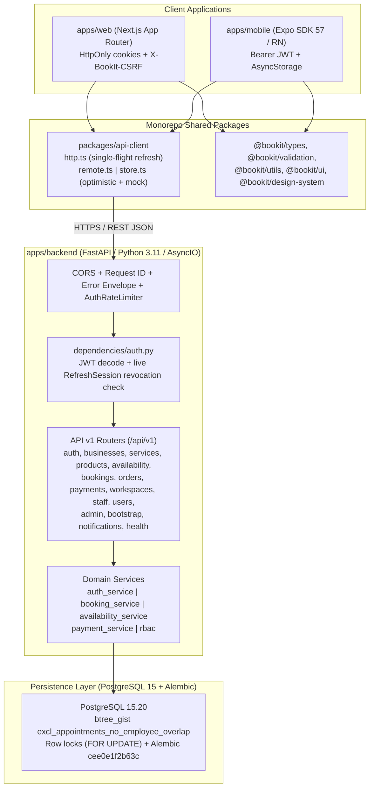

# BookIt — Independent Security & Architecture Audit

**Scope:** `apps/backend` (FastAPI + SQLAlchemy 2 + PostgreSQL + Alembic), `apps/web` (Next.js), `apps/mobile` (Expo / React Native), and `packages/api-client`.  
**Reference Standards:** OWASP ASVS v4.0, OWASP API Security Top 10 (2023).  
**Status:** Security audit completed, critical/high backend defects remediated and regression-tested, verification executed against local PostgreSQL 15.20 and all TypeScript workspaces.

---

## 1. Executive Summary

BookIt has a solid foundational backend architecture—normalized PostgreSQL relational schema, database-level `btree_gist` exclusion constraints preventing double-booking, Argon2id password hashing, SHA-256 hashed opaque refresh tokens with family reuse revocation, `HttpOnly` + CSRF double-submit cookies for web, and bearer JWTs for mobile.

However, the audit identified **10 security, concurrency, authorization, and business-logic weaknesses** in the backend alongside several **open architectural and frontend integration risks**:

- **Fixed & Verified (Backend):**
  1. Active access JWTs remained valid after logout, password change, password reset, account deactivation, refresh reuse revocation, and admin suspension because `get_optional_user` did not check `RefreshSession` revocation status.
  2. Clients could pass `?enforceNotice=false` on booking creation and reschedule to bypass minimum notice/max-advance constraints and book dates in the past (`2020-01-06`).
  3. Concurrent `POST /auth/refresh` requests lacked row-level locking on `RefreshSession` and hardcoded `remember=True` on rotated cookies.
  4. Rate limiting trusted spoofable `X-Forwarded-For` headers unconditionally and omitted throttling on `/auth/refresh`, `/auth/verify`, `/auth/verify/request`, `/auth/change-password`, `/businesses/applications`, `/businesses/{id}/messages`, and QR check-in.
  5. Unapproved/non-public business details leaked via sub-resources (`GET /businesses/{id}/services`, `/staff`, `/availability`, `GET /services/{id}`, `GET /products/{id}`, `POST /businesses/{id}/messages`), and `GET /bootstrap` leaked platform-wide KPIs (`platformRevenue`, `pendingApplications`, `totalUsers`, etc.) to non-admin callers.
  6. Rescheduling an appointment against an overlapping time failed against its own prior slot; concurrent duplicate `idempotencyKey` booking requests raced behind the employee `FOR UPDATE` lock and returned `409`; customers could self-check-in via QR on `"pending"` bookings and overwrite `checked_in_at`.
  7. Cart/checkout omitted seller approval checks, ignored `ProductVariant.stock` during `PATCH /cart/items/{id}`, returned stale cached `cart.items` due to `expire_on_commit=False`, omitted deterministic lock ordering across multi-seller checkouts, ignored `PromoCode.expires_on`, and allowed sellers to regress completed orders back to `"pending"`.
  8. Concurrent duplicate payment webhooks raised uncaught `IntegrityError` (500) instead of returning idempotent `duplicate: true`, and out-of-order `payment.succeeded` webhooks could overwrite `"refunded"`.
  9. Review creation accepted arbitrary foreign `appointmentId` / cross-business `productId` and unapproved targets; `POST /workspaces/{id}/notes` returned `500` on nonexistent `customerId`; admin review moderation did not recalculate business ratings; admin suspension left active sessions alive.
  10. Shared non-unique `User.phone` values (e.g., `+1 206 555 0100` across seeded staff) caused `MultipleResultsFound` HTTP 500 during login/password reset; concurrent duplicate customer registrations raised uncaught `IntegrityError` 500; password-reset email dispatch passed raw username/phone `identifier` instead of resolved `user.email`.

- **Open Risks Requiring Follow-Up:**
  - `apps/mobile/services/session.tsx` stores `accessToken` and `refreshToken` in plaintext `AsyncStorage` (`expo-secure-store` is not installed).
  - Rate limiting in `apps/backend/app/core/rate_limit.py` is in-memory per worker (requires Redis for multi-worker deployments).
  - `@bookit/api-client` (`packages/api-client/src/store.ts`) uses silent fire-and-forget optimistic sync; `lastSyncError` is not surfaced in Web or Mobile UI.
  - Staff workspace invite-acceptance endpoint is missing (`status="invited"` blocks workspace API access with `403`).
  - `checkInByQrRemote` exists in `@bookit/api-client` and backend, but QR scanner/check-in UI is not wired in `apps/mobile`.

All **23 backend pytest tests** (16 existing + 7 new security regression suites), **Ruff lint**, **8-workspace TypeScript typecheck**, **API client smoke test**, and **Alembic schema drift check (`alembic check`)** passed after the final code edit.

---

## 2. Architecture Overview

BookIt is structured as a monorepo combining a shared TypeScript core with Next.js (`apps/web`), Expo React Native (`apps/mobile`), and a FastAPI + PostgreSQL backend (`apps/backend`).

### Architectural Observations, Duplication & Incomplete Flows
- **Dual Mock + Live State Engine (`packages/api-client`):** `store.ts` maintains a full in-memory simulation alongside `remote.ts` REST calls. Several Web and Mobile components invoke optimistic store mutators (`store.ts`) that silently swallow live backend failures into `lastSyncError` rather than calling `*Remote` methods directly or surfacing server errors.
- **Unwired Mobile QR Check-In:** `POST /api/v1/bookings/businesses/{business_id}/check-in` and `checkInByQrRemote` (`packages/api-client/src/remote.ts`) are implemented and tested, but no screen in `apps/mobile` or `apps/web` calls `checkInByQrRemote`.
- **Unfinished Staff Invite Lifecycle (`apps/backend/app/api/v1/endpoints/staff.py`):** `POST /workspaces/{id}/team/invite` creates `Membership(status="invited")`. `auth_service.user_workspaces` includes `status != "suspended"` (so `"invited"` appears in `session.workspaces`), while `rbac.get_active_membership` strictly requires `status == "active"`, resulting in `403 Forbidden` with no invite-acceptance endpoint to transition `"invited"` to `"active"`.
- **Sandbox Integrations:** Payments (`payment_service.py`), email verification/password reset delivery (`auth.py`), and push notifications do not connect to external providers (Stripe/SMTP/FCM); Stripe webhook verification and real delivery adapters remain milestone work.

---

## 3. Security & Business Logic Findings (Ranked)

### High Severity — Remediated & Verified

#### H1. Active Access JWTs Remained Valid After Logout, Password Change, Reset, Deactivation & Admin Suspension
- **OWASP:** ASVS V3.3 (Session Termination), API2:2023 (Broken Authentication).
- **Root Cause:** `get_optional_user` (`apps/backend/app/api/dependencies/auth.py`) decoded the JWT (`sub` + `exp`) and checked `User.status`, without checking whether the linked `RefreshSession` (`sid` claim) had been revoked.
- **Fix:** `get_optional_user` now requires `sid` in the access JWT payload and queries `RefreshSession(id=sid, user_id=sub, revoked_at IS NULL, expires_at > now)`. Logout (`POST /auth/logout`), password change (`POST /auth/change-password`), password reset confirmation (`POST /auth/password-reset/confirm`), account deactivation, refresh reuse detection, and admin user suspension (`PATCH /admin/users/{id}`) now revoke active access tokens immediately.
- **Verification:** `test_logout_and_password_change_revoke_active_access_jwt` and `test_review_idor_moderation_recalculates_rating_admin_suspension_and_webhook_order` (passed).

#### H2. Client `?enforceNotice=false` Query Parameter Bypassed Advance-Notice & Past-Date Booking Controls
- **OWASP:** API6:2023 (Unrestricted Access to Sensitive Business Flows).
- **Root Cause:** `POST /api/v1/bookings` and `POST /api/v1/bookings/{id}/reschedule` (`apps/backend/app/api/v1/endpoints/bookings.py`) accepted client-controlled `enforce_notice: bool = Query(...)`, allowing any attacker to book or reschedule into closed/past dates (e.g., `2020-01-06`). `GET /businesses/{id}/availability` also defaulted `enforceNotice` to `false`.
- **Fix:** Removed client `enforceNotice` override from booking creation and rescheduling (`enforce_advance_window=True` always enforced server-side) and defaulted `GET /businesses/{id}/availability` to `enforceNotice=True`. Confirmed frontend does not use `?enforceNotice`.
- **Verification:** `test_booking_past_slot_blocked_reschedule_self_overlap_and_idempotency_race` (passed).

#### H3. Concurrent Refresh Token Rotation Race & `remember` Cookie Downgrade
- **OWASP:** ASVS V3.2, API2:2023.
- **Root Cause:** `rotate_refresh_session` (`apps/backend/app/services/auth_service.py`) loaded `RefreshSession` without a row lock, allowing concurrent `/auth/refresh` requests with the same token to both pass `revoked_at is None` checks before either committed. Additionally, `POST /auth/refresh` (`endpoints/auth.py`) hardcoded `remember=True` instead of preserving the original session TTL.
- **Fix:** Added `.with_for_update()` to `RefreshSession` lookup in `rotate_refresh_session`, computed original `remember` from `(existing.expires_at - existing.created_at) > timedelta(days=2)`, and returned it to `_set_session_cookies`.
- **Verification:** `test_concurrent_refresh_race_allows_only_one_winner` asserts concurrent calls resolve strictly to `[200, 401]` (passed).

#### H4. Spoofable `X-Forwarded-For` Rate Limit Bypass & Unthrottled Auth/OTP Endpoints
- **OWASP:** API4:2023 (Unrestricted Resource Consumption), API2:2023.
- **Root Cause:** `client_ip_from_request` (`apps/backend/app/core/rate_limit.py`) unconditionally trusted client-supplied `X-Forwarded-For` headers, enabling trivial brute-force bypass by rotating header IPs. Several sensitive endpoints (`/auth/refresh`, `/auth/verify/request`, `/auth/verify`, `/auth/change-password`, `/businesses/applications`, `/businesses/{id}/messages`, `/bookings/businesses/{id}/check-in`) lacked rate limits, and `/auth/password-reset/confirm` used IP-only bucketing rather than `(ip, identifier)`.
- **Fix:** Added `trust_proxy_headers: bool = False` in `apps/backend/app/core/config.py`; `client_ip_from_request` ignores `X-Forwarded-For` unless explicitly enabled behind a trusted proxy. Added `auth_rate_limiter.enforce(...)` to all listed endpoints and tightened `/password-reset/confirm` to `(ip, identifier)`.
- **Verification:** `test_rate_limit_blocks_xff_spoofing_and_otp_brute_force` (passed).

#### H5. Unapproved/Non-Public Business Data Leakage & Bootstrap Admin KPI Disclosure
- **OWASP:** API1:2023 (Broken Object Level Authorization), API3:2023 (Excessive Data Exposure).
- **Root Cause:** Direct sub-resource endpoints (`GET /businesses/{id}/services`, `/staff`, `/availability`, `GET /services/{id}`, `GET /products/{id}`, `POST /businesses/{id}/messages`) did not enforce `business.is_public and business.status == "approved"`, exposing draft/pending/suspended businesses and inactive catalog items. Additionally, `GET /api/v1/bootstrap` exposed full `platformStats` (`platformRevenue`, `pendingApplications`, `totalUsers`, `totalBookings`, `totalOrders`, `activeSubscriptions`) to unauthenticated and customer callers.
- **Fix:** Added `ensure_business_visible` in `apps/backend/app/services/rbac.py` (raises `404` for non-members/non-admins on hidden businesses) and applied it across all affected endpoints plus hiding `active=False` services/products from non-members. Redacted sensitive `platformStats` counters to `0` for non-admin callers in `apps/backend/app/api/v1/endpoints/bootstrap.py`.
- **Verification:** `test_unapproved_business_catalog_and_bootstrap_redaction` (passed).

#### H6. Reschedule Self-Overlap, Concurrent Idempotency Race & Pending Self-Check-In
- **OWASP:** API6:2023, Concurrency / Integrity.
- **Root Cause:**
  1. `reschedule_appointment_transactional` (`apps/backend/app/services/booking_service.py`) did not exclude the appointment being rescheduled when computing availability, blocking valid reschedules overlapping its current window.
  2. Two concurrent requests sharing `idempotencyKey` both passed the pre-lock check; after the winner released the `Employee` `FOR UPDATE` lock, the second request saw the slot was now taken and returned `409` instead of re-checking `idempotency_key` and returning the created booking.
  3. `check_in_appointment_by_qr` permitted customers to self-check-in on unapproved `"pending"` bookings and overwrote existing `checked_in_at` timestamps on replay.
- **Fix:** Added `exclude_appointment_id` to `load_availability_for_service`; re-checked `idempotency_key` immediately after acquiring the `Employee` `FOR UPDATE` lock (and in the `IntegrityError` fallback); restricted `"pending"` QR check-in to authorized workspace staff and preserved initial `checked_in_at`.
- **Verification:** `test_booking_past_slot_blocked_reschedule_self_overlap_and_idempotency_race` (passed).

### Medium Severity — Remediated & Verified

#### H7. Commerce Variant Stock Bypass, Stale Cart Serialization, Deadlock Ordering, Expired Promos & Order Regression
- **Files:** `apps/backend/app/api/v1/endpoints/orders.py`.
- **Fixes Applied:**
  - Verified `seller.is_public and seller.status == "approved"` in `add_cart_item` and `checkout_cart`.
  - Checked `ProductVariant.stock` (instead of parent `Product.stock`) in `update_cart_item` when `variant_id` is set.
  - Added `.execution_options(populate_existing=True)` in `_get_or_create_cart` so SQLAlchemy (`expire_on_commit=False`) returns updated `cart.items` immediately after cart mutations.
  - Added deterministic `(seller_id, product_id, variant_id)` sorting before locking `Product` and `ProductVariant` rows (`with_for_update()`) to prevent PostgreSQL deadlocks on multi-vendor/multi-item checkouts.
  - Added `with_for_update()` and `PromoCode.expires_on >= today_iso` enforcement during checkout.
  - Added `ALLOWED_ORDER_TRANSITIONS` state machine + `with_for_update()` in `update_order_status`.
- **Verification:** `test_cart_variant_stock_promo_expiry_rollback_and_order_transitions` (passed).

#### H8. Concurrent Payment Webhook `IntegrityError` 500 & Out-of-Order Status Downgrade
- **File:** `apps/backend/app/services/payment_service.py`.
- **Fixes Applied:**
  - Handled concurrent `IntegrityError` on `PaymentWebhookEvent.event_id` unique constraint via rollback + graceful `{processed: True, duplicate: True}` response.
  - Locked target `Payment` row `with_for_update()` and blocked `"payment.succeeded"` from downgrading an already `"refunded"` payment.
- **Verification:** `test_review_idor_moderation_recalculates_rating_admin_suspension_and_webhook_order` (passed).

#### H9. Review IDOR/Moderation Rating Drift, Note FK 500 & Admin Suspension Session Persistence
- **Files:** `apps/backend/app/api/v1/endpoints/workspaces.py`, `apps/backend/app/api/v1/endpoints/admin.py`.
- **Fixes Applied:**
  - `create_review`: Verified business visibility/approval, confirmed `appointment_id` belongs to the caller and target business, and confirmed `product_id` belongs to target business.
  - `add_customer_note`: Verified `customer_id` exists (`404` instead of uncaught FK `IntegrityError` `500`).
  - `moderate_review`: Recalculated `business.review_count` and rounded `business.rating` across published reviews when visibility changes.
  - `set_user_status`: Revoked active `RefreshSession` rows immediately when suspending/deactivating a user.
- **Verification:** `test_review_idor_moderation_recalculates_rating_admin_suspension_and_webhook_order` (passed).

#### M1. Registration Race 500, Reset Email Identifier Bug & Shared-Phone `MultipleResultsFound` 500
- **Files:** `apps/backend/app/services/auth_service.py`, `apps/backend/app/api/v1/endpoints/auth.py`.
- **Fixes Applied:**
  - Wrapped `register_customer` commit in `IntegrityError` -> `409 Conflict`.
  - Fixed `request_password_reset_token` to return `(user.email, code)` so username/phone reset requests target `user.email`.
  - Fixed `find_user_by_identifier` to resolve unique `email`/`username` first and return `None` if multiple accounts share a non-unique `phone` (preventing `MultipleResultsFound` HTTP 500 on `+1 206 555 0100`).
- **Verification:** `test_logout_and_password_change_revoke_active_access_jwt` (passed).

---

### Open Findings (Unmodified — Architectural / Frontend / Infrastructure)

| Severity | Area | Finding | Risk / Impact |
| :--- | :--- | :--- | :--- |
| **High** | Mobile (`apps/mobile/services/session.tsx`) | `accessToken` and `refreshToken` are persisted in unencrypted `AsyncStorage` (`expo-secure-store` not installed). | Tokens are readable on rooted/jailbroken devices or unencrypted backups. |
| **Medium** | Rate Limiter (`apps/backend/app/core/rate_limit.py`) | Sliding-window rate limit buckets live in Python process memory. | Bypassed across multiple Uvicorn/Gunicorn workers or horizontal replicas; resets on restart. |
| **Medium** | Frontend Sync (`packages/api-client/src/store.ts`) | Optimistic store mutators fire-and-forget `syncRemote(...)`, storing failures in `lastSyncError` which Web/Mobile UIs never display. | Users can believe mutations succeeded when backend returned `403`/`409`/network error. |
| **Medium** | Mobile Auth UX (`apps/mobile/app/(customer)/*`, `(workspace)/*`) | When `onAuthFailure` clears `remoteSession`, customer/workspace tabs lack an automatic redirect guard back to login (unlike Web's `useRequireUser`). | Stale authenticated shell remains rendered after forced revocation/expiry. |
| **Medium** | Staff Onboarding (`apps/backend/app/api/v1/endpoints/staff.py`) | `invite_member` sets `Membership.status = "invited"` with no invite-acceptance endpoint; `require_business_permission` demands `status == "active"`. | Invited team members see workspaces in session payload yet receive `403` on every workspace call. |
| **Medium** | Payment & Notification Providers | Stripe SDK checkout/webhooks, SMTP email verification/reset, and mobile push delivery are stubbed behind sandbox/log modes. | Production payments and password resets cannot be delivered until provider adapters are wired. |
| **Low** | Frontend Config & Auth UI | `apiBaseUrl()` defaults to cleartext `http://localhost:8000` when env vars are missing; login screens display demo credential hints and placeholder Google/Apple buttons. | Misconfigured production builds fall back to `localhost`; placeholder OAuth buttons degrade UX. |

---

## 4. Database Audit Findings

Inspected `apps/backend/app/models/*`, `apps/backend/migrations/env.py`, and `apps/backend/migrations/versions/cee0e1f2b63c_initial_schema.py`:

- **Concurrency & Constraints:**
  - `appointments` enforces PostgreSQL `EXCLUDE USING gist (employee_id WITH =, tstzrange(start_at, end_at, '[)') WITH &&) WHERE (status IN ('pending', 'confirmed'))` (`excl_appointments_no_employee_overlap`) plus `CheckConstraint('end_at > start_at')` (`ck_appointment_valid_range`), unique `idempotency_key`, and unique `check_in_code`.
  - Unique constraints verified on `users.email`, `users.username`, `refresh_sessions.token_hash`, `memberships(user_id, business_id)`, `favorites(user_id, target_type, target_id)`, `promo_codes(business_id, code)`, `carts.user_id`, `subscriptions.business_id`, `payments.idempotency_key`, `payments.provider_reference`, and `payment_webhook_events.event_id`.
- **Foreign Keys & Cascading Behavior:**
  - High-integrity financial/booking references correctly use `ON DELETE RESTRICT` (`businesses.owner_user_id`, `orders.address_id`, `orders.seller_id`, `order_items.product_id`, `appointments.employee_id`, `appointments.service_id`, `products.category_id`, `subscriptions.plan_id`), preventing accidental erasure of active booking/order history.
  - Owned child tables (`addresses`, `refresh_sessions`, `verification_tokens`, `cart_items`, `order_items`, `product_variants`, `appointment_status_history`) correctly cascade.
- **Schema & Operational Gaps Identified:**
  1. **`users.phone` is non-unique & unindexed**, while `seed.py` seeds 10 staff users with identical phone `+1 206 555 0100` (login crash fixed at query layer in `find_user_by_identifier`; consider partial/unique phone index if phone login is required in production).
  2. **`orders` lacks an `idempotency_key` column**; checkout deduplication relies on `SELECT ... FOR UPDATE` on `carts` emptying cart items atomically, rather than returning a replay response if a client retries `POST /checkout` after network timeout.
  3. **`TimestampMixin` (`models/base.py`) updates `updated_at` via SQLAlchemy ORM `onupdate`**, not PostgreSQL database triggers—bulk SQL `UPDATE` statements bypassing ORM will not bump `updated_at`.
  4. **Alembic & Fresh DB Initialization:**
     - `alembic current` confirmed `cee0e1f2b63c (head)`.
     - `alembic check` confirmed **zero schema drift** (`No new upgrade operations detected.`).
     - `alembic upgrade head --sql` cleanly generates all **93** schema DDL statements including `CREATE EXTENSION IF NOT EXISTS btree_gist`.
     - **Deployment Caveat:** The `bookit` PostgreSQL role does not have `CREATEDB` or superuser privileges; therefore, `op.execute("CREATE EXTENSION IF NOT EXISTS btree_gist")` requires a privileged DBA or trusted-extension grant when provisioning a brand-new database before running migrations. Also, `apps/backend/tests/conftest.py` uses `Base.metadata.create_all` rather than running `alembic upgrade head` in tests.

---

## 5. Frontend Integration Findings

Inspected `packages/api-client/src/{http.ts,remote.ts,store.ts}`, `apps/web/{lib/session.tsx,components/shell.tsx,app/login/page.tsx}`, and `apps/mobile/{services/session.tsx,app/(auth)/login.tsx,app/(customer)/*,app/(workspace)/*}`:

- **Web (`apps/web`) — Good Baseline Security:**
  - In live mode (`useRemoteApi`), `apps/web/lib/session.tsx` deletes any legacy `localStorage` bearer token and relies on backend `HttpOnly` cookies + `bookit_csrf` (`X-BookIt-CSRF` header echoed on mutating requests via `http.ts`).
  - `packages/api-client/src/http.ts` implements single-flight token refresh (`refreshInFlight`) to prevent refresh-rotation collisions from concurrent browser API calls.
  - Protected routes use `useRequireUser` to redirect signed-out users cleanly.
- **Mobile (`apps/mobile`) — Needs Hardening Before Store Release:**
  - `apps/mobile/services/session.tsx` stores `accessToken` and `refreshToken` in plaintext `AsyncStorage` (`bookit.mobile.access`, `bookit.mobile.refresh`) because `expo-secure-store` is not installed.
  - Customer and workspace tabs lack reactive navigation redirects if background refresh fails (`onAuthFailure`) mid-session.
  - `checkInByQrRemote` is exported in `@bookit/api-client` (`packages/api-client/src/remote.ts`), but no QR scanner or check-in UI screen exists in `apps/mobile` or `apps/web`.
- **Shared Client (`packages/api-client`):**
  - Optimistic store updates (`store.ts`) swallow async `remote.ts` rejections into `lastSyncError`, leaving the user without feedback if a booking/cart/profile update fails server validation unless components explicitly invoke `*Remote` helpers.

---

## 6. Executed Tests & Verification Results

All checks below were executed in the workspace after the final code modifications:

| Check | Exact Command | Outcome |
| :--- | :--- | :--- |
| **Backend Pytest Suite** | `PYTHONPATH=apps/backend apps/backend/.venv/bin/pytest -c apps/backend/pyproject.toml apps/backend/tests -v` | **23 passed in 14.12s** (0 failures; covers auth, CSRF, rate-limit/XFF, concurrency double-booking, GIST exclusion, idempotency race, availability, RBAC/IDOR, catalog visibility, bootstrap redaction, cart variant stock, promo expiry, checkout rollback, order transitions, webhooks, review moderation, admin suspension) |
| **Backend Linter** | `apps/backend/.venv/bin/ruff check apps/backend/app apps/backend/tests apps/backend/scripts` | **All checks passed!** |
| **Alembic Head & Drift Check** | `PYTHONPATH=apps/backend apps/backend/.venv/bin/alembic -c apps/backend/alembic.ini current && ... check` | **`cee0e1f2b63c (head)`**; **`No new upgrade operations detected.`** |
| **Alembic Offline SQL DDL** | `PYTHONPATH=apps/backend apps/backend/.venv/bin/alembic -c apps/backend/alembic.ini upgrade head --sql` | Exited `0`; generated **93** `CREATE TABLE`/`CREATE INDEX`/`EXCLUDE USING` DDL statements |
| **Fresh DB Create Test** | Attempted `CREATE DATABASE bookit_audit_fresh` as DB role `bookit` | Failed with `InsufficientPrivilegeError: permission denied to create database` (role lacks `CREATEDB`; main `bookit` DB left untouched) |
| **Workspace TypeScript Checks** | `npm run typecheck` | **Passed across all 8 workspaces** (`@bookit/mobile`, `@bookit/web`, `@bookit/api-client`, `@bookit/design-system`, `@bookit/types`, `@bookit/ui`, `@bookit/utils`, `@bookit/validation`) |
| **API Client Smoke Test** | `npm run smoke` | **Passed**: `BookIt API smoke test passed (14 public venues, booking apt_501, 2 orders).` |

---

## 7. Files Modified / Added

All modifications during this audit were restricted to `apps/backend` (no frontend files were altered):

- `apps/backend/app/core/config.py` — Added `trust_proxy_headers: bool = False`.
- `apps/backend/app/core/rate_limit.py` — Restricted `X-Forwarded-For` trust to `trust_proxy_headers=True`.
- `apps/backend/app/api/dependencies/auth.py` — Bound access JWT validation to live unrevoked, unexpired `RefreshSession(id=sid)`.
- `apps/backend/app/services/auth_service.py` — Added `with_for_update()` on refresh rotation; preserved original `remember` flag; fixed registration `IntegrityError` handling, password reset email lookup, and shared-phone `MultipleResultsFound` crash.
- `apps/backend/app/api/v1/endpoints/auth.py` — Preserved `remember` cookie TTL on `/refresh`; fixed password reset recipient email; added rate limits to `/refresh`, `/verify/request`, `/verify`, `/change-password`, and `(ip, identifier)` throttling on `/password-reset/confirm`.
- `apps/backend/app/services/rbac.py` — Added `ensure_business_visible` to block non-member/non-admin access to unapproved/non-public businesses.
- `apps/backend/app/api/v1/endpoints/businesses.py` — Enforced `ensure_business_visible` on sub-resources and rate-limited `POST /businesses/applications`.
- `apps/backend/app/api/v1/endpoints/services.py` — Enforced `ensure_business_visible` and active-only visibility on `GET /services/{id}`.
- `apps/backend/app/api/v1/endpoints/products.py` — Enforced `ensure_business_visible` and active-only visibility on `GET /products/{id}`.
- `apps/backend/app/api/v1/endpoints/availability.py` — Enforced `ensure_business_visible` and defaulted `enforceNotice=True`.
- `apps/backend/app/api/v1/endpoints/bootstrap.py` — Redacted sensitive `platformStats` counters for non-admin callers.
- `apps/backend/app/api/v1/endpoints/notifications.py` — Enforced `ensure_business_visible` and rate-limited `POST /businesses/{id}/messages`.
- `apps/backend/app/services/booking_service.py` — Added `exclude_appointment_id` for reschedules, post-lock `idempotency_key` re-check + `IntegrityError` recovery, pending QR self-check-in protection, and `checked_in_at` preservation.
- `apps/backend/app/api/v1/endpoints/bookings.py` — Removed client `enforceNotice=false` override; rate-limited QR check-in.
- `apps/backend/app/api/v1/endpoints/orders.py` — Fixed `_get_or_create_cart` identity-map refresh (`populate_existing=True`), seller approval verification, `ProductVariant.stock` check in `update_cart_item`, deterministic checkout lock ordering, `PromoCode` lock & expiry check, and `ALLOWED_ORDER_TRANSITIONS`.
- `apps/backend/app/services/payment_service.py` — Added concurrent duplicate webhook `IntegrityError` recovery and `with_for_update()` row locking preventing `"refunded"` downgrade.
- `apps/backend/app/api/v1/endpoints/workspaces.py` — Added `customer_id` validation on customer notes and business/appointment/product validation on reviews.
- `apps/backend/app/api/v1/endpoints/admin.py` — Revoked active `RefreshSession` rows on admin suspension and recalculated `business.rating` / `review_count` on review moderation.
- `apps/backend/tests/test_security_hardening.py` — Added 7 security, concurrency, authorization, and rollback regression test suites.
- `apps/backend/SECURITY_AUDIT.md` — Added this security & architecture audit report.

---

## 8. Remaining Risks & Trade-Offs

1. **Access-Token Revocation DB Check Trade-off:** Checking `RefreshSession` on every authenticated request guarantees immediate logout/suspension revocation without waiting up to 15 minutes for JWT expiry, at the cost of one primary-key lookup per request. At higher scale, this lookup can be cached in Redis with negative-TTL invalidation on revocation.
2. **In-Memory Rate Limiter:** Safe and deterministic for single-process testing/staging, but must be backed by Redis before running multi-worker (`--workers > 1`) production instances.
3. **Mock/Live Client Parity:** Preserving `packages/api-client/src/store.ts` kept existing UI smoke tests and offline demos working without rewriting frontends, at the cost of background sync errors (`lastSyncError`) remaining invisible until UI error banners are wired.

---

## 9. Recommended Next Milestones

1. **Mobile Secure Token Storage & Session Guard:** Replace `AsyncStorage` token keys in `apps/mobile/services/session.tsx` with `expo-secure-store`, add reactive auth-expiry redirect guards across mobile customer/workspace layouts, and surface `lastSyncError` toasts/banners in Web and Mobile.
2. **Redis Rate Limiting & Session Revocation Cache:** Migrate `AuthRateLimiter` (`apps/backend/app/core/rate_limit.py`) to Redis sliding windows and configure `TRUST_PROXY_HEADERS=true` only behind your verified reverse proxy/load balancer.
3. **Complete Staff Invite & Mobile QR Check-In Flows:** Add `POST /workspaces/{id}/team/invitations/{membership_id}/accept` (or token-based invite acceptance) and wire the camera QR scanner screen in `apps/mobile` to `checkInByQrRemote`.
4. **Live Provider Integrations & Production Guardrails:** Wire Stripe Checkout + signed webhook secrets, transactional email (SES/Postmark/Resend) with `DEBUG_LOG_VERIFICATION_CODES=false`, `Order.idempotency_key` migration, and a CI job executing `alembic upgrade head` on a disposable PostgreSQL container before `pytest`.
